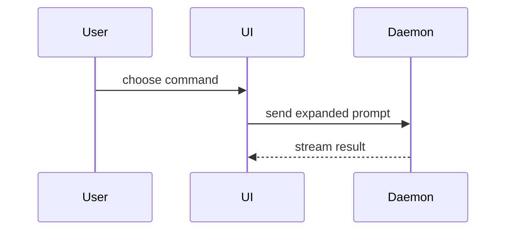

# PR

Use this template for writing the PR body:

```markdown
## Summary

<diagram, diff-sketch, or tree>

## Evidence

- **Before:** <screenshot/output/failing test run>
  **After:** <screenshot/output/passing test run>

## Merge Danger

**Door:** <one-way or two-way>

<optional: description>

**Blast Radius:** <one-word description>

<optional: potential ramifications of merge>
```

This skill shapes the body only. It does not push, open, or edit a PR; those
side effects belong to [publish-draft-pr](../publish-draft-pr/SKILL.md) or an
explicit user request.

## One Body, Two Readers

The same body is the engineer's local review handoff and the pull request
description. There is no separate change summary: the engineer reviews exactly
what a PR reviewer will later read.

- Write it to `.scratch/<feature-slug>/pr-body.md`, or to the path the caller
  names, and show it to the engineer in the conversation.
- When a PR is opened later, reuse that file. Rewrite it first only if the diff
  changed after it was written; never draft a second, competing body.

## Sources

Write from the reviewed diff against the correct base, plus the ticket, spec,
or execution plan that motivated it, so the door call reflects intent and not
only the diff. When they exist, also draw on implementation, review, and repair
summaries and `orchestration/run-summary.md`. Use them as evidence; do not
paste them in.

Skip all preambles and keep prose brief: the body starts at `## Summary`. Use
the project's domain language from its established glossary (`GLOSSARY.md` or
`CONTEXT.md`, following the root map when contexts are scoped).

If the repository has a PR template (for example
`.github/pull_request_template.md`), fill that template and place Summary,
Evidence, and Merge Danger inside it rather than producing two competing
bodies. Repository guidance wins where it says otherwise.

## Sections

### Summary

Pick the smallest view that makes the key point clear.

- Show logic or an algorithm as pseudocode:

```text
on(save)
  if content is unchanged
    return cached result
  write new content
  return fresh result
```

- Show runtime control flow as a call tree:

```text
submitForm
  createSession
    persistPrompt
    launchAgent
  navigateToSession
```

- Show UI structure as a component tree, including state and module boundaries that matter:

```text
<SessionPage> (apps/example/src/routes/session.tsx)
  useSessionEvents()
  <SessionToolbar>
    <RunSkillButton> (packages/ui)
```

- Show file responsibility or a broad refactor as a shallow file tree:

```text
src/
├── commands/       # parses user actions
├── sessions/       # owns session state
└── transport/      # sends API requests
```

- Show component interaction, control flow, or data flow with Mermaid:



- Use `diff` when the point is what changes and the surrounding shape already exists. Match the diff shape to the topic.

For a component change:

```diff
 <SessionPage>
   useSessionEvents()
   <SessionToolbar>
+    <RunSkillButton />
   <SessionTimeline>
+    <SkillResultCard />
```

For a file-layout change:

```diff
 src/
 ├── commands/
+│   └── show-me.ts       # expands the slash command
 ├── sessions/
-└── transport.ts
+└── transport/
+    ├── client.ts
+    └── stream.ts
```

For a call-tree or call-stack change:

```diff
 submitForm
   createSession
     persistPrompt
+    expandSkillMention
     launchAgent
-  navigateToSession
+  navigateToSession
+    subscribeToEvents
```

For a state or control-flow change:

```diff
 on(save)
-  write content
+  if content is unchanged
+    return cached result
+  write new content
+  invalidate cache
```

- Show the whole block when most of it is new, when omitted context would hide ownership or order, or when the user needs a copyable target shape:

```ts
function expandSkill(command: string): string {
  const skillName = command.slice(1);
  return `use the ${skillName} skill`;
}
```

#### Guidance

Place each visual next to the short text it supports. Keep only the calls, files, props, states, and boundaries a reviewer needs to understand the change.

You may use one of these, you may use several, it is unlikely you will use all of them. Use your judgement and don't overwhelm the reviewer. A call tree, file tree, or shaped diff reads the same everywhere; Mermaid renders on GitHub and GitLab but not in a terminal.

### Evidence

Concrete evidence that the change works. Show a before and after.

Screenshots are S-tier - when the environment is set up for it and the change is visual.

Execution-based evidence is A-tier. Test results, console output. Show the exact test that now fails and passes, using pseudocode. "Tests are green" on its own is a claim, not a before and after.

For a bug fix, state the confirmed root cause in one line next to the evidence.

### Merge Danger

Describe whether it's a one-way or two-way door. You can walk back through two-way doors, but not one-way doors. A PR that is cheap to roll back is lower risk. Changes that involve destructive actions or hard-to-reverse decisions are one-way doors: schema or data migrations, deletes, public API removals, and anything that ships outward (emails, webhooks, published packages). Rolling back a commit does not unsend a message, and a flagged rollout stays two-way only until the first write lands in the new format. Check repository guidance for changes it always treats as one-way.

You are grading your own change, so be most skeptical when the call is "two-way, small blast radius".

The blast radius is the potential impact or scope of the changes introduced by this PR. Consider all possibilities. Examples are layout shift, breakages for consumers, mobile responsiveness, etc. List deferred review findings and decisions that still need a human here.

### Trace (optional)

Add a short `## Trace` section last only when the PR comes from a ticket or an
`ai-workflow` run. Keep it to reference lines: the Jira or issue key, the
workflow terminal state from `orchestration/run-summary.md` (stated honestly,
including non-`PASS` states), and a caller-supplied run or session link. Do not
link local `.scratch/` paths a reviewer cannot open.

## Final Check

- The Summary visual alone tells a reviewer what changed.
- Evidence shows a before and an after.
- The body states a door and a blast radius.
- Nothing contains secrets, tokens, private URLs, or raw logs.
- If the body is huge because the diff is huge, say so; the fix is a smaller PR, not a longer body.
